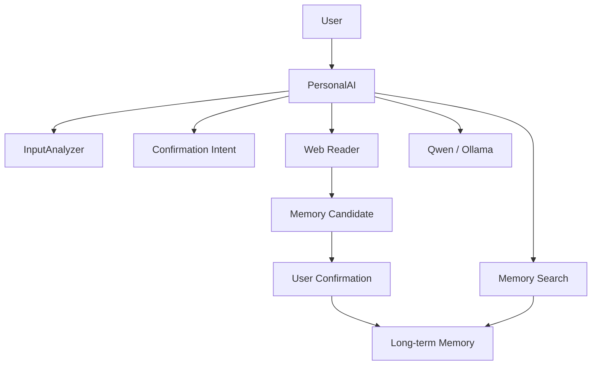
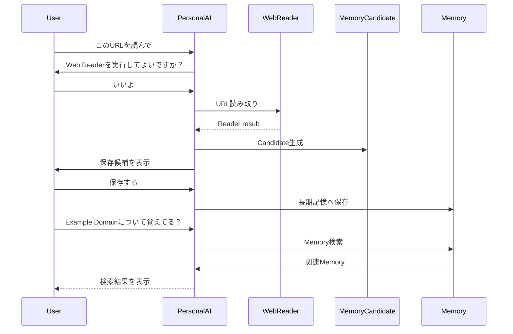

# PersonalAI

## 概要

PersonalAIは、ローカルLLM、長期記憶、Web Reader、Memory Candidate、安全な確認フローを組み合わせた、個人用AIアシスタント開発プロジェクトです。

単なるチャットボットではなく、ユーザーの情報を読み取り、必要に応じて記憶し、あとから検索して活用できるAIを目指しています。

現在はCLI中心のローカル実行プロジェクトとして、Qwen / Ollama、SQLite、Pythonを使って段階的に開発しています。

## 開発背景

ChatGPTや開発支援AIを使う中で、会話履歴や作業文脈が切れるたびに、同じ説明を繰り返す課題がありました。

PersonalAIでは、会話履歴、長期記憶、Reader、Permission、Tool実行ログを段階的に組み合わせ、ユーザーの作業を継続的に支援できるローカルAIアシスタントを作っています。

## 何を目指しているか

PersonalAIは、ユーザーの作業入口になるAIを目指しています。

- ユーザーの目的を理解する
- 必要な情報を読み取る
- 長期的に役立つ情報をMemory Candidateとして整理する
- 保存前にユーザー確認を挟む
- 保存したMemoryをあとから確認・検索できるようにする
- 未実装機能をできたふりしない
- 後から拡張しやすいAIエージェント基盤に育てる


## 現在できること

実装済みの主な機能:

- Qwen / Ollamaを使ったローカル会話
- 会話履歴の保存
- 長期記憶基盤
- ユーザー入力の分析
- URL入力の検出
- Web Reader
- Web Reader実行前の確認
- File Reader（単一のtxt/mdファイル）
- File Reader実行前の確認
- PDF Reader（単一のPDFファイル）
- PDF Reader実行前の確認
- 確認待ち状態の文脈解釈（Web Reader / File Reader / PDF Reader共通）
- 読み取り結果の整形表示
- Reader結果をQwenでの応答に接続（読んで要約・読んだ内容への追加質問）
- Reader結果からMemory Candidateを生成
- Memory Candidateのdry-run表示
- Memory Candidate編集dry-run
- 保存する / 保存しない / 編集して保存 / 後で確認 の確認応答
- Memory Candidateをユーザー確認つきで長期記憶へ保存する基礎
- 保存したMemory Candidateの内容を直近保存結果として確認する基礎
- Memory検索
- 保存済みMemoryを簡易キーワード検索する基礎
- ToolRunner / PermissionManager による安全な実行設計
- Verごとのチェックスクリプト
- 開発自走方針
- MIGRATION.mdによるClaude Code / Cursor移行引継ぎ

## 未実装の機能

以下は将来構想であり、現時点では未実装です。

- Image Reader
- YouTube Reader
- File Reader（txt/md以外の拡張子、複数ファイル、ディレクトリ読み取り）
- PDF Reader（複数ファイル、ディレクトリ読み取り）
- Word / Excel / PowerPoint Reader
- Office連携（作成・編集）
- メール連携
- カレンダー連携
- LLM Intent Resolver
- ModelRouter
- ToolRouter
- OpenAI / Claude / Gemini 接続
- GUI
- PC操作
- ベクトル検索
- 高度なMemory検索
- Memory編集・削除UI
- Reader結果全文のDB保存
- Memory Candidate専用テーブル

## 今後のロードマップ

近い候補:

- Word Reader（.docx）
- Excel Reader（.xlsx）
- PowerPoint Reader（.pptx）
- LLM Intent Resolverの段階的実装

将来候補:

- YouTube Reader
- Office連携（作成・編集）
- メール・カレンダー連携
- 高度なMemory検索
- README用スクリーンショット/GIF追加

## 技術スタック

- Python
- SQLite
- SQLAlchemy
- Ollama
- Qwen
- PowerShell
- Git / GitHub
- ローカル実行中心のCLI構成

### AIモデルの方針

現時点ではQwen / Ollamaを中心にローカル環境で開発しています。

将来的には、LLM Intent Resolver、Memory抽出、資料読解、複雑なコード読解など、高精度な処理が必要な場面でOpenAIの利用も検討します。

OpenAI利用は、都度確認ではなく月間上限額を決めた運用とし、上限額の範囲内であれば都度確認しません。ただし、上限額の初回設定・引き上げ、APIキー設定、個人情報・機密情報の外部送信は必ず事前に確認する方針です。

## アーキテクチャ概要

現在のPersonalAIは、以下のような責務分離を進めています。



補助的な処理の流れ:

```text
User Input
↓
InputAnalyzer
↓
CapabilityManager
↓
Planner
↓
Router
↓
Executor / ToolRunner
↓
Qwen / Web Reader
↓
Memory Candidate dry-run
↓
Response
```

主な構成:

- `core/personal_ai.py`: 会話処理の中心
- `core/input_analyzer.py`: 入力分類
- `core/capability_manager.py`: 現在扱える能力の判定
- `core/planner.py`: 行動計画
- `core/router.py`: 実行先選択
- `core/executor.py`: LLM実行や未実装応答
- `core/tool_runner.py`: Tool実行入口
- `core/web_reader_adapter.py`: Web Reader
- `core/memory_candidate.py`: Reader結果からMemory Candidateを生成
- `core/memory_candidate_confirmation.py`: Memory Candidate確認応答dry-run
- `core/memory_candidate_saver.py`: Memory Candidateのユーザー確認つき保存
- `core/memory_search.py`: 保存済みMemoryの簡易キーワード検索
- `database/`: 会話履歴とMemory基礎
- `docs/`: 設計方針と開発履歴
- `scripts/`: バージョンごとの自動チェック

## デモ: Web Reader → Memory Candidate → 保存 → 検索

Web ReaderからMemory Candidate確認応答までの流れは、以下に記録しています。

- `docs/demo_logs/web_reader_memory_candidate_demo.md`

### Web Reader → Memory保存 → 直近確認

```text
このURLを読んで https://example.com
いいよ
保存する
今保存した記憶を確認して
```

期待される動作:

1. Web Reader実行前に確認する
2. `いいよ` を確認許可として解釈する
3. URLを読み取る
4. Memory Candidateを表示する
5. `保存する` で長期記憶に保存する
6. 直近保存Memoryを確認できる

### Memory検索

```text
Example Domainについて覚えてる？
```

期待される動作:

1. 保存済みMemoryを検索する
2. 関連Memoryがあれば表示する
3. 見つからない場合は自然に未発見を伝える

## 処理フロー

Web Readerで読み取った内容をすぐ長期記憶へ入れず、Memory Candidateとして確認してから保存します。



## 技術的に工夫した点

- Reader結果をすぐ保存せず、Memory Candidateとして一度ユーザー確認を挟む設計
- 確認待ち状態では、通常会話に流す前に文脈に応じて確認応答として解釈する設計
- 保存・検索・直近確認を分けることで、Memoryの扱いを段階的に実装
- 自動チェックではfake reader / fake saveを使い、実DBや外部通信への影響を避ける
- Web ReaderはURL検出だけでは実行せず、ユーザー確認後に実行する
- 失敗時に読めたふり、保存したふり、実行したふりをしない
- AGENTS.md / MIGRATION.mdにより、AIエージェントが開発方針を引き継げる構成
- 実装済みと未実装を分け、ポートフォリオとして正直に説明できる構成

安全設計は、開発を止めるためではなく、外部アクセス、DB破壊、Memory物理削除、Git履歴破壊、課金、外部送信などの致命的リスクを避けながら通常開発を自走しやすくするために整理しています。

## 将来的に扱いたい領域

PersonalAIは、開発補助だけでなく、資料要約・資料作成・Web検索・データ分析・勉強・創作支援・予定管理・メール支援まで広く扱える個人AIアシスタントを目指しています。

将来的には、画像、音声、動画、YouTube、PDF / Word / Excel / PowerPoint、コードエディタ、ゲームエンジン、Office系ツール、ノートアプリ、画像・動画・音楽制作ツールなどとの連携も視野に入れています。

具体的なアプリ名は固定せず、用途や開発段階に応じて選びます。
具体的なアプリは固定せず、必要なツールは目的に合わせて選びます。

## 安全設計

PersonalAIでは、安全設計を初期段階から分けて考えています。

- Web ReaderはURL検出だけでは実行しない
- 外部Webアクセス前に確認する
- 確認待ち中は `はい` だけでなく `いいよ` / `お願いします` などを文脈上の許可として扱う
- 確認待ち中の不明入力は通常会話へ流さず、確認を聞き直す
- 失敗時に読めたふりをしない
- Memory Candidateは勝手に保存しない
- `保存する` と明示された場合だけ低リスク候補を保存する
- 保存後に直近保存内容を確認できる
- 保存済みMemory検索はDBスキーマ変更はしない方針で、キーワード検索から始める
- 高リスク候補は自動保存しない
- DBスキーマ変更はしていない
- PermissionManagerで高リスク操作を止める土台を用意
- DB削除、Memory物理削除、Git履歴書き換え、課金、外部送信は確認必須

## セットアップ

前提:

- Windows
- PowerShell
- Python 3.10系
- Python venv
- Ollama
- Qwenモデル

依存関係は既存の仮想環境を使います。

```powershell
venv\Scripts\python.exe --version
```

## 実行方法

CLIでPersonalAIを起動します。

```powershell
venv\Scripts\python.exe -B app.py
```

終了するときは、会話内で `exit` を入力します。

## チェック方法

Ver2.xの標準チェック:

```powershell
venv\Scripts\python.exe -B scripts\run_ver2_checks.py
```

Ver2.22固有チェック:

```powershell
venv\Scripts\python.exe -B scripts\check_ver2220.py
```

補助確認:

```powershell
git diff --check
git status
```

Codex環境ではSQLiteの `disk I/O error` が出る場合があります。
その場合もDBを削除・初期化せず、権限付き再実行で通るかを確認します。

## 開発・移行ドキュメント

- `AGENTS.md`: AIエージェント向けの短い運用ルール
- `docs/claude_code_start.md`: Claude Codeへ移行する際の開始手順
- `MIGRATION.md`: Claude Code / Cursorなど新しい開発環境移行のための引継書
- `docs/development_workflow.md`: AIエージェントによる開発自走方針
- `docs/project_handoff.md`: プロジェクト再開用の引継ぎ
- `docs/check_workflow.md`: チェック運用
- `docs/changelog.md`: 変更履歴
- `docs/portfolio_readme_policy.md`: READMEをポートフォリオとして見せる方針

各バージョンで専用のcheckスクリプトを追加し、既存機能を壊さないように確認しています。

## ポートフォリオとしての位置づけ

PersonalAIは、就活ポートフォリオとして使うことも想定して開発しています。

ローカルLLM、長期記憶、Web Reader、Memory Candidate、安全な確認フロー、GitHubでの段階的開発履歴を通じて、AIエージェントを設計・実装・改善するプロセスを示すことを目的としています。

現在の詳細な開発バージョンは `docs/project_handoff.md` と `docs/changelog.md` を参照してください。

Web Reader、Memory Candidate dry-run、編集dry-run、ユーザー確認つき保存、直近保存内容の確認、確認待ち状態の文脈解釈、保存済みMemoryの簡易キーワード検索、Claude Code移行用MIGRATION.mdまで整備済みです。
Claude Code移行時の開始手順として `docs/claude_code_start.md` も、Claude Code自走運用の入口として `CLAUDE.md` も追加済みです。
ただし、Reader結果全文のDB保存、Memory Candidate専用テーブル、本格的なMemory検索UI、ベクトル検索、LLMによる高度な文脈検索はまだ行っていません。

Mermaid図、デモ導線、技術的に工夫した点をREADME上で確認できるようにし、GitHub閲覧者や面接官に開発意図が伝わりやすい構成にしています。
